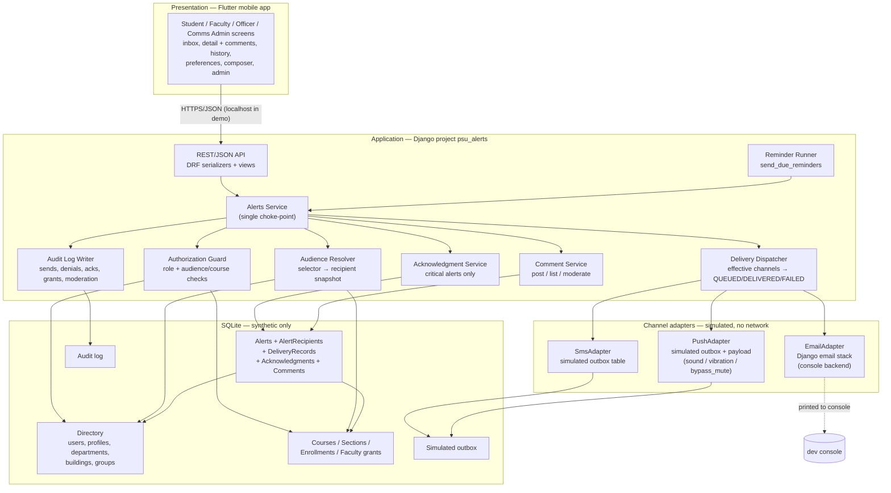
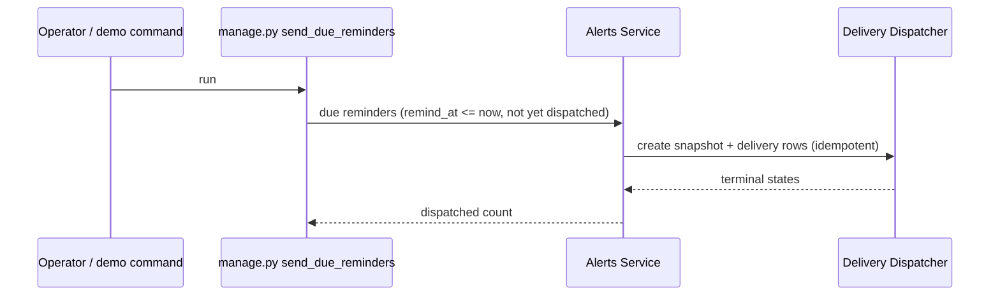

# Architecture — PSU Alerts & Notifications

*Phase 2 deliverable (T2.1), revision 3 (2026-11-02). Companion docs:
[data model & API contract](data-model-and-api.md),
[backend structure](backend-structure.md),
[screen navigation](screen-navigation.md),
[ADR-001](adr/ADR-001-stack-deployment-ui.md),
[ADR-002](adr/ADR-002-delivery-simulation.md),
[security/privacy/accessibility](security-privacy-accessibility.md),
[reconciliation](../reconciliation-2026-11-02.md).*

## Shape of the system

A **three-tier client-server architecture with a layered backend**, matching
`Design Doc.md` §1:

1. **Presentation** — a Flutter mobile app (Android/iOS) for students,
   faculty, officers and Communications admins.
2. **Application** — one Django service split into views (REST/JSON), a
   service layer, and models. Every state change funnels through the service
   layer so authorization, snapshotting, delivery and audit rules have exactly
   one place to live (NFR-1, AC-3.6).
3. **Data** — one relational database (SQLite for the prototype) holding only
   synthetic records.

Email, SMS and push are simulated inside the backend (console email, local
outbox for SMS/push); no external service is contacted (C-2, NFR-2). The
Flutter app is a thin client: it renders and calls the API, and holds no
authorization logic.

The Django application layer is the system of record for:

1. **Authentication and login** — validates credentials, issues/invalidates
   tokens, and resolves each user to a role family (Student, Faculty, Admin).
2. **Role-based authorization** — derives the user's permitted parameters
   (send rights, audience scopes, course/section grants, management access)
   and rejects anything outside them.
3. **Alert creation** — validates required fields, severity/category/priority
   rules, and persists sender, server timestamp and alert ID atomically.
4. **Audience/group selection** — resolves the chosen selector (campus, role,
   department, building, group, course, section) against live directory and
   enrollment data, then snapshots the recipients.
5. **Acknowledgment tracking** — records explicit acknowledgments for
   `CRITICAL` alerts, idempotently, with server timestamps and read-state
   coupling.
6. **Rejection and audit** — refuses unauthorized requests with HTTP 401/403
   and records each rejection (actor, action, object, reason, timestamp) in
   the append-only audit log (AC-3.8, NFR-5).



## Role and audience model

| Role family | Role | May send | May target | Notes |
|-------------|------|----------|------------|-------|
| Student | `student` | no | — | receives, reads, acknowledges critical, comments, sets preferences |
| Faculty | `faculty` | `ADVISORY`/`INFORMATIONAL` (optionally urgent) | only assigned `course`/`section` | course/section grants checked server-side (AC-3.1, AC-14.1) |
| Admin | `officer` | any severity | granted department/building/group/campus scopes | denial audited (AC-3.2) |
| Admin | `comms_admin` | any severity | any audience | manages categories, grants, comments, reports |
| Review only | `psu_it` | no | — | review role only; no runtime delivery privileges |

The **three role families are Student, Faculty and Admin**; the backend derives
the user's permitted parameters (which senders, audiences, courses and
management endpoints) from the family plus the stored grants. Authorization is
resolved in Django, never in Flutter (AC-3.6). Every rejected request — wrong
role, wrong audience, wrong course, or anonymous — is refused with HTTP
401/403 and written to the audit log with actor, action, object and reason
(AC-3.8, NFR-5).

Course/section targeting resolves through `Enrollment` rows that are
**active at send time**. The resolved users are copied into
`AlertRecipient` and never re-resolved (AC-2.4, NFR-11). Faculty severity is
limited at the service layer, not in the Flutter form (AC-14.4).

## Send flow (happy path, course path and denied path)

```mermaid
sequenceDiagram
    actor S as Sender (officer / comms_admin / faculty)
    participant APP as Flutter app
    participant API as REST API
    participant SVC as Alerts Service
    participant G as Authorization Guard
    participant R as Audience Resolver
    participant D as Delivery Dispatcher
    participant A as Audit Log

    S->>APP: compose (title, body, severity, category, audience, channels)
    APP->>API: POST /api/alerts/
    API->>SVC: send_alert(actor, request)
    SVC->>G: check(actor, audience, severity, is_urgent)
    alt allowed (in scope, faculty severity/course rules pass)
        G-->>SVC: allowed
        SVC->>R: resolve(audience) at send time
        R-->>SVC: recipient snapshot (non-empty, else 400)
        SVC->>SVC: persist Alert + AlertRecipient (atomic)
        SVC->>D: dispatch(alert, snapshot, channels, preferences)
        D->>D: effective channels; forced push if urgent/exam
        D->>D: per recipient × channel: QUEUED → DELIVERED / FAILED
        SVC->>A: SEND_OK (alert id, audience, counts)
        SVC-->>API: 201 + alert id
        API-->>APP: 201 + summary
    else outside scope or severity not allowed
        G-->>SVC: denied
        SVC->>A: SEND_DENIED (actor, requested audience, reason)
        SVC-->>API: 403 — nothing delivered
        API-->>APP: 403
    end
```

Key properties:

- **One choke-point (SVC):** the Flutter app and any future client use the
  same rules; authorization tests hit the API directly (AC-3.6, NFR-1).
- **Denial is a first-class event:** blocked sends are audited (AC-3.2,
  AC-7.3).
- **Snapshot before dispatch:** later directory/enrollment edits cannot
  rewrite history (AC-2.4, NFR-11).
- **Priority is data, not client behaviour:** `is_urgent`,
  `priority_source`, and the push payload fields are computed server-side
  (US-16). The Flutter app only renders them.

## Reminder flow (no external scheduler)



No Celery, no broker, no external cron service. The command is safe to run
repeatedly; a unique dispatch marker per (alert, recipient) makes it
idempotent (AC-15.4). This is a deliberate prototype simplification recorded
in [ADR-002](adr/ADR-002-delivery-simulation.md).

## Django app layout (module view)

| App | Owns | Maps to |
|-----|------|---------|
| `accounts` | login/logout, tokens, Profile (campus + system role), sender grants, demo accounts | auth inputs to the service layer |
| `directory` | Department, Building, Group, seed command | DIR |
| `courses` | Course, Section, Enrollment, FacultyAssignment, deadlines | COURSES |
| `alerts` | Alert, AlertRecipient, DeliveryRecord, Acknowledgment, Category, Comment, preferences, service layer, channel adapters, reminder command | SVC, AUTHZ, RESOLVE, DELIVERY, ACK, COMMENTS, REMIND |
| `audit` | AuditLogEntry, writer API, export | AUDIT, LOG |
| `psu_alerts` | settings, root URLs, health check, deployment guards | project shell |

The `alerts` app is the only app allowed to change alert state; other apps call
its service functions, never the ORM tables directly. `courses` owns
enrollment truth but asks `alerts` to snapshot recipients.

File-level layout, service boundaries and conventions:
[backend-structure.md](backend-structure.md).

## Flutter client structure

| Area | Screens | Notes |
|------|---------|-------|
| Auth | Login, language switch | PSU-shaped synthetic accounts; token in secure storage |
| Recipient | Inbox/announcements, alert detail + comments, history, preferences | Inbox orders by priority (NFR-8); EN/AR + RTL |
| Sender | Compose, course picker (faculty), audience picker (officer/admin), delivery/ack report | Faculty form hides `CRITICAL` and non-course audiences |
| Admin | Categories, sender grants, reports, audit export, comment moderation | Inside the app; no web dashboard |
| Shared | Offline/error states, empty states, confirmation dialogs | Touch targets ≥44 px, 360–430 px widths |

Details: [screen-navigation.md](screen-navigation.md).

## Deployment boundary

Local only for the demo: Django `manage.py runserver` + SQLite file + a Flutter
app running in an emulator/device on the same machine. No containers, no
production WSGI, no external services at runtime. `scripts/run_demo` starts the
backend and prints the Flutter run command. Delivery simulation runs
synchronously inside the request (ADR-002).

NFR-22 guard: if `DEBUG=False` or the host is not localhost, the settings
require HTTPS/secure cookies and an explicit encrypted-storage acknowledgement;
otherwise startup fails with the offending setting named. The demo itself is
localhost + synthetic data and does **not** claim encrypted storage.

PSU handoff boundary (NFR-6): before real use — PSU SSO/OAuth, real channel
gateways behind the adapter interface, HTTPS termination, encrypted storage,
rate limiting/abuse controls, retention policy, accessibility and privacy
review, and a load test beyond SQLite's write ceiling (NFR-24).

## Revision 2026-11-02

- Presentation changed from Django templates to the **Flutter** app specified
  in `Design Doc.md`.
- Added Course/Section/Enrollment/FacultyAssignment and course-scoped
  authorization (US-14).
- Added Comment service and moderation (US-17).
- Added exam/deadline reminder runner and schedule-change fields (US-15/16).
- Added priority override fields and simulated push payload semantics
  (US-16).
- Delivery SLA is now explicit (NFR-23) and concurrency has a target (NFR-24).
- Previous revision (2026-10-20) remains valid for US-9…US-13; its preference
  logic is extended by category opt-outs and mandatory categories.
