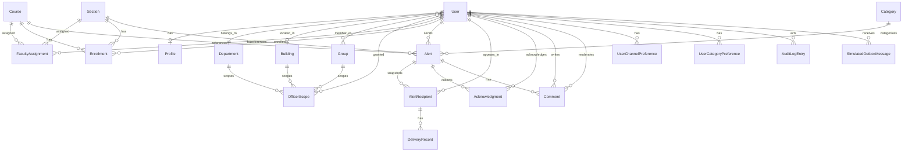

# Data Model & API Contract — PSU Alerts & Notifications

*Phase 2 deliverable (T2.2), revision 3 (2026-11-02). Field lists are the
design contract; Phase 3 implementation may add internal fields but may not
remove or re-purpose these without an impact analysis. AC references point to
[requirements.md](../requirements.md).*

## Entity-relationship overview



## Entities

### Profile (extends Django `auth.User`)

| Field | Type | Notes |
|-------|------|-------|
| user | FK User | one-to-one |
| campus_role | enum `STUDENT / FACULTY / EMPLOYEE` | audience targeting (US-2) |
| system_role | enum `RECIPIENT / OFFICER / COMMS_ADMIN` | highest held role; default `RECIPIENT` (US-3, US-8). `RECIPIENT` maps to the **Student** or **Faculty** role family via `campus_role`; `OFFICER` and `COMMS_ADMIN` both map to the **Admin** family, with capabilities narrowed by stored audience/course grants. |
| department | FK Department, nullable | targeting + default scope |
| building | FK Building, nullable | targeting |
| synthetic_email | string, `@example.edu` pattern only | **never real addresses** (NFR-1) |
| synthetic_phone | string, nullable | drives the deterministic SMS failure rule (AC-4.4) |
| student_id | string, nullable, indexed | PSU-shaped identifier for demo accounts (NFR-21) |

### Directory: Department / Building / Group

Plain taxonomy tables (`name`, `code`). Group is M2M to User. Seeded by a
repeatable management command over a synthetic population (~60 people,
4 departments, 6 buildings — A-10). Selector vocabulary for AC-2.1:
`everyone`, `role:<campus_role>`, `department:<id>`, `building:<id>`,
`group:<id>`, `course:<id>`, `section:<id>`.

### Courses, Sections, Enrollments

| Entity | Fields | Notes |
|--------|--------|-------|
| `Course` | `code`, `title`, `department`, timestamps | replaces the vague "college/course" mention; synthetic only |
| `Section` | `course`, `code`, `term`, timestamps | e.g. CS-101-01 |
| `Enrollment` | `user` (student), `section`, `status` `ACTIVE/INACTIVE`, `enrolled_at` | active at send time (AC-14.3, AC-14.7) |
| `FacultyAssignment` | `user` (faculty), `course`, `section` nullable, `granted_by`, `granted_at` | course/section grants (AC-3.1, AC-14.1). Nullable `section` means whole course |

### OfficerScope (US-8, AC-3.1)

| Field | Type | Notes |
|-------|------|-------|
| user | FK User | the officer |
| scope_type | enum `CAMPUS_WIDE / DEPARTMENT / BUILDING / GROUP` | |
| department / building / group | FK, nullable, one filled per scope_type | CHECK-constrained |
| granted_by | FK User | comms_admin who granted (AC-8.1) |
| created_at | datetime | audit-adjacent |

Unique together: (user, scope_type, target). Revocation = row delete; effect
on next send attempt (AC-8.2).

### Category (US-11)

| Field | Type | Notes |
|-------|------|-------|
| code | string, PK/unique | machine code `CLOSURE`, `SAFETY`, `EVENT`, `SCHEDULE`, `OTHER`, `EXAM`, `DEADLINE` |
| name_en | string | English label |
| name_ar | string | Arabic label (NFR-19) |
| is_active | bool | deactivated unusable for new sends (AC-11.2) |
| created_at / updated_at | datetime | audit-adjacent |

### Alert (US-1, US-6, US-14, US-15, US-16)

| Field | Type | Notes |
|-------|------|-------|
| id | PK | system-assigned (AC-1.1) |
| title / body | strings | required (AC-1.2); stored as entered, no translation (A-20) |
| severity | enum `CRITICAL / ADVISORY / INFORMATIONAL` | config-driven list (A-4) |
| category | FK Category | required (AC-11.1) |
| audience_selector_type + audience_selector_ref | enum + ref | what the sender asked for (AC-2.1) |
| course / section | FK, nullable | set for course/section alerts (AC-14.5) |
| exam_date / exam_time / exam_location / exam_instructions | string/date/time, nullable | structured exam fields (AC-15.1) |
| deadline_at / remind_at | datetime, nullable | deadline/reminder (AC-15.3) |
| old_location / new_location / old_time / new_time | string, nullable | schedule change (AC-16.6) |
| is_urgent | bool, default false | priority override (AC-16.1) |
| priority_source | enum `NORMAL / EXAM / DEADLINE / SCHEDULE / URGENT` | derived at send time (AC-15.2, AC-16.4) |
| allow_comments | bool, default true | US-17 |
| created_by | FK User, nullable | immutable sender; null only for system-created reminders with marker (AC-1.1, AC-15.6) |
| created_by_system | bool, default false | audit marker for automated reminders |
| created_at | datetime | server timestamp, immutable (AC-1.1, NFR-5) |
| expires_at | datetime | explicit or created_at + 24 h default (A-6, Q9) |
| lifecycle | derived `ACTIVE / EXPIRED` | computed from expires_at (AC-6.1); never deletes rows |

No edit/cancel fields — updates to title/body/severity/category after send are
rejected at the service layer (AC-1.4, A-9). Priority/urgency are immutable
(AC-16.5).

### AlertRecipient (AC-2.4)

Snapshot row per resolved recipient: (alert, user, resolved_selector,
course_section_ref). Written at send time, never rewritten. Holds
`read_at` (nullable) set on first view (US-13).

### DeliveryRecord (US-4)

| Field | Type | Notes |
|-------|------|-------|
| alert_recipient | FK AlertRecipient | one row per channel |
| channel | enum `EMAIL / SMS / PUSH` | effective channel (AC-4.1, AC-12.3) |
| status | enum `QUEUED / DELIVERED / FAILED` | state machine (AC-4.1, AC-4.2) |
| forced | bool, default false | true if forced on by urgency/exam/schedule (AC-12.3) |
| attempted_at / completed_at | datetimes | for latency measurement (NFR-7, NFR-23) |
| failure_reason | string, nullable | e.g. `no_mobile_on_profile` (AC-4.4) |

Deterministic failure rule v1: `SMS` to a recipient with
`synthetic_phone IS NULL` → FAILED with that reason. Nothing here ever holds
a real address or phone (NFR-1, NFR-3).

### Acknowledgment (US-5)

(alert, user, acknowledged_at), unique per (alert, user) — repeat ack is
idempotent (AC-5.2). Created only for CRITICAL alerts (AC-5.1); the service
rejects acks for other severities or for alerts not sent to that user
(AC-5.3). Creating an acknowledgment sets `read_at` on the corresponding
`AlertRecipient` if not already set (AC-5.2, AC-13.2).

### UserChannelPreference (US-12)

| Field | Type | Notes |
|-------|------|-------|
| user | FK User | |
| channel | enum `EMAIL / SMS / PUSH` | |
| enabled | bool, default true | |

Unique per (user, channel).

### UserCategoryPreference (US-12)

| Field | Type | Notes |
|-------|------|-------|
| user | FK User | |
| category | FK Category | |
| enabled | bool, default true | |

Unique per (user, category). Only categories marked `OPT_OUT_ALLOWED` may be
disabled; `EXAM`, `DEADLINE`, `CLOSURE`, `SAFETY` are always enabled
(AC-12.6).

### Comment (US-17)

| Field | Type | Notes |
|-------|------|-------|
| alert | FK Alert | |
| author | FK User | |
| body | text | trimmed, 1–500 chars, HTML-escaped (AC-17.2) |
| created_at | datetime | server timestamp |
| removed_at | datetime, nullable | soft delete (AC-17.4) |
| removed_by | FK User, nullable | comms_admin or self-removal marker |
| removal_reason | string, nullable | optional, audit-adjacent |

### AuditLogEntry (US-7, NFR-5)

| Field | Type | Notes |
|-------|------|-------|
| actor | FK User, nullable | system actions may be null (e.g. reminder run) |
| action | enum `SEND_OK / SEND_DENIED / REQUEST_DENIED / ACK / READ / SCOPE_GRANTED / SCOPE_REVOKED / COURSE_GRANT_GRANTED / COURSE_GRANT_REVOKED / LOGIN_FAILED / LOGOUT / PREF_UPDATE / COMMENT_POST / COMMENT_REMOVE / CATEGORY_CHANGE / REMINDER_DISPATCH` | extensible; `REQUEST_DENIED` covers non-send role/audience rejections (AC-3.8) |
| object_type / object_id | string/int | alert, scope, comment, … |
| detail | JSON | IDs and counts only — **no contact data** (NFR-3) |
| created_at | datetime | append-only |

Append-only; no update/delete paths exposed.

### SimulatedOutboxMessage (AC-4.2)

| Field | Type | Notes |
|-------|------|-------|
| channel | enum `EMAIL / SMS / PUSH` | |
| recipient | FK User | |
| alert | FK Alert | |
| payload | JSON | includes `sound`, `vibration_pattern`, `bypass_mute` for push (AC-4.6, AC-16.3) |
| body_preview | text | |
| created_at | datetime | inspectable in demos/tests |

## API contract

Base: `/api/`. Auth: token (API) or session (UI); login via
`/api/auth/login/`. Error shape: `{"detail": str, "fields": {…?}}`.
All endpoints except login and `/api/health/` require authentication.

| Method + path | Who | Success | Failure | AC |
|---------------|-----|---------|---------|----|
| `POST /api/auth/login/` | anyone | 200 + token | 401 | 9.1, 9.5 |
| `POST /api/auth/logout/` | authenticated | 204 | 401 | 9.2 |
| `POST /api/auth/language/` | anyone (session-based) | 204 + cookie | 400 | NFR-19 |
| `GET /api/health/` | anyone | 200 `{"status":"ok"}` | — | NFR-4 |
| `POST /api/alerts/` | officer, comms_admin, faculty | 201 + alert id + recipient_count | 400 missing/invalid fields · 400 zero recipients · 403 out of scope · 403 wrong role/severity/course | 1.1–1.5, 2.3, 3.2–3.7, 14.1–14.4, 15.1, 15.3, 16.1–16.2 |
| `GET /api/alerts/` | officer, comms_admin, faculty | 200 list (scoped) | 403 | 7.1, 7.5, 10.2 |
| `GET /api/alerts/{id}/` | sender within scope, comms_admin, recipient of alert | 200 + delivery summary + comments | 403/404 | 4.3, 6.6, 7.2, 14.6 |
| `GET /api/alerts/{id}/recipients/` | sender within scope, comms_admin | 200 per-recipient delivery + read + ack | 403 | 4.3, 5.4, 7.2 |
| `GET /api/me/alerts/` | authenticated recipient | 200 own history, newest first, priority ordered in announcements | 401 | 6.2–6.6, 10.1 |
| `POST /api/me/alerts/{id}/acknowledge/` | recipient of that critical alert | 200/409 idempotent | 400 not critical · 403 not their alert | 5.1–5.3 |
| `POST /api/me/alerts/{id}/read/` | recipient of that alert | 204 idempotent | 403/404 | 13.1, 13.4 |
| `GET/PATCH /api/me/preferences/` | self only | 200/204 | 403 | 12.1–12.5 |
| `GET/POST /api/alerts/{id}/comments/` | recipient of alert (post), recipients/sender/comms_admin (list) | 200/201 | 401/403 · 409 if disabled · 400 invalid body | 17.1–17.3, 17.6 |
| `DELETE /api/comments/{id}/` | author or comms_admin | 204 soft delete | 403/404 | 17.4 |
| `GET /api/directory/{departments\|buildings\|groups\|courses\|sections}/` | authenticated (filtered by grants) | 200 | 403 | 2.1, 14.1 |
| `GET/POST /api/admin/categories/` `PATCH/POST /{id}/deactivate/` | comms_admin | 200/201/204 | 403 | 11.2 |
| `GET/POST /api/admin/officer-scopes/` `DELETE /{id}/` | comms_admin | 200/201/204 | 403 | 8.1–8.3 |
| `GET/POST /api/admin/course-grants/` `DELETE /{id}/` | comms_admin | 200/201/204 | 403 | 8.1, 8.4, 14.1 |
| `GET /api/admin/reports/alerts/` | comms_admin (+ faculty restricted via separate endpoint) | 200 system-wide or own-course report | 403 | 7.1, 7.2, 7.5 |
| `GET /api/admin/audit-log/?format=json\|csv` | comms_admin | 200 export | 403 | 7.3–7.4 |
| `GET /api/outbox/` (dev only) | authenticated staff/comms_admin in local env | 200 inspectable simulated outbox | 403 in non-dev or non-staff | AC-4.2 |

### Example send request/response (course + urgent exam)

```json
POST /api/alerts/
{
  "title": "Midterm Exam Details",
  "body": "Room change and instructions.",
  "severity": "ADVISORY",
  "category": "EXAM",
  "audience": {"type": "section", "ref": "cs101-01"},
  "channels": ["EMAIL", "SMS", "PUSH"],
  "is_urgent": true,
  "exam_date": "2026-11-10",
  "exam_time": "09:00",
  "exam_location": "Building B, Room 204",
  "exam_instructions": "Bring student ID."
}
→ 201
{
  "id": 87,
  "created_at": "2026-11-02T08:00:00Z",
  "recipient_count": 24,
  "priority_source": "EXAM",
  "delivery": {"QUEUED": 72, "DELIVERED": 0, "FAILED": 0}
}
```

### Localization additions

| Entity / concern | Change | Notes |
|------------------|--------|-------|
| `Category` | `name_en` + `name_ar` | Seeded bilingual (A-21); API returns both, Flutter picks by active language |
| Severity labels | Presentation layer only | Enum stays machine-coded; EN/AR display strings from ARB + vocabulary |
| Alert title/body | **unchanged** — stored as entered | No machine translation (A-20) |
| Language selection | Cookie-based via `/api/auth/language/` | Session-persisted; Flutter reads the same cookie or sends the header |

## Management commands

| Command | Purpose | Notes |
|---------|---------|-------|
| `manage.py seed_demo` | Create synthetic users, courses, sections, enrollments, categories, default prefs | Idempotent, uses `@example.edu` and synthetic phones |
| `manage.py reset_demo` | Drop and reseed the database to known state | NFR-12 |
| `manage.py send_due_reminders` | Dispatch due deadline reminders once per (alert,recipient) | Idempotent, audit-logged (AC-15.4, AC-15.6) |
| `manage.py check_nfr_guards` | Validate deployment/config guards | Used by tests (NFR-13, NFR-22) |

## Schema notes

- SQLite in WAL mode (`PRAGMA journal_mode=WAL`) for concurrent reads/writes
  (NFR-24). PostgreSQL is the handoff for higher concurrency.
- All foreign keys have indexes; `AlertRecipient` has a unique (alert,user)
  constraint.
- `AuditLogEntry` has no updated_at and no delete operation exposed.
- `Comment` uses soft delete (`removed_at` nullable).
- `AlertRecipient.read_at` is set atomically on first read/ack (idempotent).
