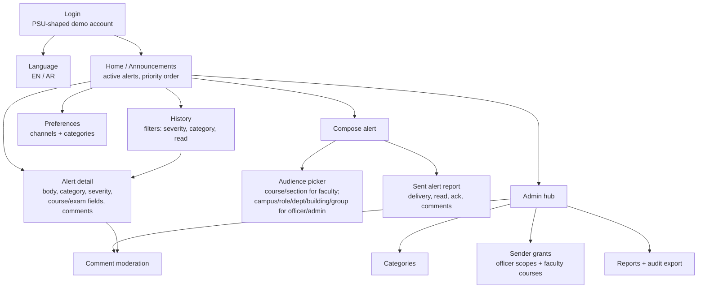

# Screen Navigation — Flutter Mobile App

*Phase 2 deliverable, added 2026-11-02 to make `Design Doc.md` §3 explicit and
testable. All screens are mobile-only (NFR-14), 360–430 logical px, touch
targets ≥44 px, bilingual EN/AR with full RTL (NFR-19/NFR-20).*

## Navigation map

## Recipient path

1. **Login** — synthetic PSU-shaped username/ID + password. Invalid login
   shows one generic error (AC-9.1); failed attempts are audited server-side.
2. **Home / Announcements** — active alerts only, ordered `CRITICAL` → urgent /
   exam / schedule-change → `ADVISORY` → `INFORMATIONAL`, newest first within
   a band (AC-6.5, AC-16.4). Expired alerts move to History (AC-6.1).
3. **Alert detail** — full body, severity, category, sender, timestamp,
   course/exam/deadline/schedule fields, read state and comments. Opening it
   marks it read (AC-13.1). A `CRITICAL` alert shows an explicit
   **Acknowledge** button; reading alone never satisfies ack (AC-13.2).
4. **History** — all alerts ever sent to the user, newest first, with
   severity/category/read/ack/delivery state; filters are server-side
   (AC-10.1). Expired alerts are fully readable (AC-6.3).
5. **Preferences** — per-channel `EMAIL`/`SMS`/`PUSH` toggles and category
   opt-outs (`EVENT`, `OTHER` only). Mandatory categories are shown as locked
   with an explanation, not silently forced (AC-12.2, AC-12.6).
6. **Comments** — recipient can post plain text, see other recipients' and the
   sender's comments, and delete their own; removed comments disappear
   (AC-17.x).

## Faculty path

1. Login → Home shows own course alerts and their delivery/read counts.
2. **Compose** — title, body, category, channels; severity limited to
   `ADVISORY`/`INFORMATIONAL`; optional **Urgent** switch with an explanation
   of the distinct sound/vibration and mute bypass (US-16).
3. **Audience picker** — only courses/sections assigned to the faculty member;
   selecting a course can narrow to a section. Other audience types are not
   shown (and the API rejects them anyway).
4. **Exam / deadline mode** — structured fields: exam date, time, location,
   instructions; or deadline + reminder time (24–48 h before) (US-15).
5. **Sent report** — per-channel counts, read counts, comments; no system-wide
   data (AC-7.5).

## Officer / Communications admin path

1. Login → Home shows the sender's alert list, filters by severity/category/
   audience type/course (AC-10.2).
2. **Compose** — all severities; campus/role/department/building/group
   audiences; channel selection; category; optional urgent (officer/admin).
3. **Sent report** — delivery totals per channel/state, read counts, yay/nay
   acknowledgment list for critical alerts, comment list with moderation
   controls (US-7, US-17).
4. **Admin hub (comms_admin only)**:
   - Categories: create, rename, deactivate; `name_en`/`name_ar`.
   - Sender grants: officer scopes and faculty course/section grants; revoke
     takes effect on the next send (AC-8.2).
   - Reports: system-wide alert list, per-alert report, audit export as JSON or
     CSV.
   - Comment moderation: remove any comment; soft delete + audit (AC-17.4).

## Explicitly absent screens

No desktop/web layout, no separate web admin dashboard, no real push/SMS
settings, no PSU SSO screen, no machine-translation control. These are handoff
items (see [reconciliation](../reconciliation-2026-11-02.md)).
